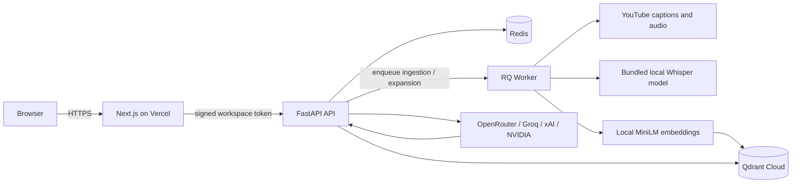

# ChannelMind — YouTube RAG with timestamp citations

ChannelMind turns a public YouTube video, playlist, or channel into a searchable knowledge base. It extracts transcripts, builds a tenant-isolated vector index, and answers questions with links to the exact video moments used as evidence.

This repository contains the web app, API, ingestion worker, channel/playlist exporter extension, and the original Streamlit prototype.

## Why this project exists

Long-form creator content contains useful knowledge, but finding one explanation across dozens of videos is slow. ChannelMind makes that content queryable while keeping answers auditable: retrieval and generation use the same chunks, and only citations that appear in the final answer are displayed.

## Production architecture



- `web/` — responsive Next.js frontend designed for Vercel.
- `api/` — FastAPI boundary, signed anonymous workspaces, validation, rate limits, job status, and health checks.
- `src/` — extraction, chunking, retrieval, LLM routing, and citation logic.
- Redis + RQ — durable background ingestion, separated from web requests.
- Qdrant — one shared collection partitioned by a mandatory tenant payload.
- Chroma — local-development fallback and legacy Streamlit storage.

Read [ARCHITECTURE.md](ARCHITECTURE.md) for trust boundaries and design decisions.

## Highlights

- One website input for public video, playlist, and channel URLs, with scope-specific status and results
- Video, playlist, and channel indexing use free captions when available or recognize speech locally from downloaded audio
- Exact timestamp citations linked back to YouTube
- Inspectable transcript passages beside answer citations and a searchable video transcript reader
- Multi-video retrieval with cross-video diversification
- Isolated, expiring workspaces for public visitors
- Background channel ingestion with job polling
- Full playlist and channel indexing with per-video progress; questions can use completed transcripts while the collection continues
- Chrome extension for whole public-channel transcript exports, resumable progress, automatic ZIP download, and file import into ChannelMind; optional owner-authorized caption mode
- Export coverage reports with transcribed, unavailable, failed, pending and indexed counts, reason totals, and paginated issue details
- Fixed-window abuse limits backed by Redis in production
- Named, configurable LLM models and token telemetry
- Prompt-injection boundary around untrusted transcript text
- Atomic transcript caching for local use
- Non-root multi-stage API container
- Pinned Python and JavaScript dependencies
- Python tests, frontend build checks, secret scanning, SAST, and dependency audits in CI

## Local development

Prerequisites: Python 3.11+, Node.js 22+, a YouTube Data API key for playlist and channel workflows, and an LLM provider key for Q&A. Processing a single public video does not require the YouTube Data API key.

```powershell
python -m venv .venv
.venv\Scripts\activate
pip install -r requirements-api.txt -r requirements-dev.txt
Copy-Item .env.example .env
```

Add the credentials you use to `.env`. Paste a public video, playlist, or channel URL into the website's source field. Video URLs include standard watch, short, Shorts, and live links; video IDs and channel handles also work. Video and playlist indexing read public captions first; if none are available, `yt-dlp` downloads audio and `faster-whisper` recognizes speech locally. The Whisper model downloads once to `LOCAL_WHISPER_MODEL_PATH` (default `data/models`) in local development. The deployed API image bundles this model and Node 22 for YouTube audio extraction.

For a playlist or channel, the API discovers and processes every entry. Duplicate, unavailable, and failed entries remain in the coverage count, and pending counts decrease as the job runs. A 32-video playlist should produce 32 indexed transcripts when all 32 videos are accessible and contain speech. Questions can use completed transcripts while the remaining videos process. Reloading the page resumes job polling in the same browser session.

The answer-source control defaults to **Transcript only**: answers must come from indexed passages and cite them. **General knowledge** is an explicit separate choice; those answers are labeled and have no video citations. The local fixed-question evaluation and current measured results are in [EVALUATION.md](EVALUATION.md).

Audio is processed in 15-minute pieces, then the timestamped text is indexed. The default multilingual `small` model runs on CPU; playlist and channel jobs process three videos concurrently by default (`LOCAL_TRANSCRIPTION_WORKERS`) with four CPU threads per model (`LOCAL_WHISPER_CPU_THREADS`). Completed transcripts are reused when the same collection is processed again in a workspace. Large collections can still take substantial time. Temporary audio files are stored under `LOCAL_AUDIO_TEMP_PATH` (default `data/tmp`) so local processing does not depend on operating-system temp-folder permissions. YouTube access is still required to fetch audio, and some private, restricted, or blocked videos cannot be processed. Q&A uses the configured external LLM provider.

For local Windows GPU transcription, install `requirements-gpu-windows.txt` and set `LOCAL_WHISPER_DEVICE=cuda` in `.env`. This uses the same multilingual model and decoding settings with the official NVIDIA CUDA libraries. The project loads the wheel DLLs from its virtual environment without a system-wide CUDA installation. `LOCAL_TRANSCRIPTION_WORKERS=2` passed a short two-video benchmark on an RTX 3050 Laptop GPU with 4 GB of memory. Collections longer than 12 entries use one worker and keep only active transcripts in memory, because two workers exhausted memory during a 212-video channel run. Set `LOCAL_AUDIO_TEMP_PATH` to a drive with ample free space for long videos. Collection time scales with the total duration of videos that lack captions.

Download the embedding model once if it is not already cached:

```powershell
python -c "from sentence_transformers import SentenceTransformer; SentenceTransformer('sentence-transformers/all-MiniLM-L6-v2')"
```

Then start the API:

```powershell
uvicorn api.main:app --reload --port 8000
```

In a second terminal:

```powershell
cd web
Copy-Item .env.example .env.local
npm ci
npm run dev
```

Open `http://localhost:3000`. Development defaults use tenant-separated local Chroma collections and an in-process background executor, so Redis and Qdrant are optional locally.

To run the API, worker, Redis and Qdrant together for local development, use Docker Compose. Start the frontend separately with `npm run dev` in `web/`. Compose uses local development settings; it is not the public deployment configuration.

```powershell
docker compose up --build
```

The legacy interface remains available with:

```powershell
streamlit run app/app.py
```

## Verification

```powershell
python -m pytest tests -q -p no:cacheprovider
python -m compileall -q api app src config.py
cd web
npm run typecheck
npm run build
cd ..
node --test extension/tests/*.test.mjs
```

Export tests use simulated Google/YouTube responses; a live public export still requires a configured YouTube API key and an installed-extension browser check. A passing unit suite does not replace a deployed video, Q&A, extension and caption-free transcription smoke test.

## Deployment

For the channel and playlist exporter extension, follow [extension/README.md](extension/README.md). Public channel and playlist exports require a YouTube Data API key and an allowed extension ID, but not channel-owner OAuth consent. The optional owned-channel mode requires a Google OAuth Web application client. The extension package can be loaded unpacked locally; it has not been published to an extension store.

The recommended v1 setup is Vercel for `web/`, Railway for the API, worker and private Redis, and Qdrant Cloud Standard for vectors. Follow the configuration, smoke checks and rollout steps in [DEPLOYMENT.md](DEPLOYMENT.md). No cloud deployment is implied by the local tests.

## API surface

| Method | Route | Purpose |
|---|---|---|
| `GET` | `/healthz` | Container health and non-sensitive runtime mode |
| `GET` | `/readyz` | Production queue, vector database and local model readiness |
| `POST` | `/api/v1/workspaces` | Issue an expiring signed workspace capability |
| `POST` | `/api/v1/workspaces/{id}/videos` | Queue one public video for caption or local speech indexing |
| `POST` | `/api/v1/workspaces/{id}/playlists` | Queue every entry in a public playlist for caption or local speech indexing |
| `POST` | `/api/v1/workspaces/{id}/ingestions` | Queue channel processing |
| `POST` | `/api/v1/workspaces/{id}/expansions` | Find and index relevant older videos for a question |
| `GET` | `/api/v1/jobs/{id}` | Poll tenant-scoped ingestion status |
| `POST` | `/api/v1/workspaces/{id}/chat` | Retrieve context and generate a cited answer |
| `GET` | `/api/v1/exports/{id}/issues` | Page through unresolved videos in a signed export workspace |
| `GET` | `/api/v1/workspaces/{id}/videos/{video_id}/transcript` | Read one indexed video's transcript with the signed workspace token |
| `DELETE` | `/api/v1/workspaces/{id}` | Delete the workspace vector partition |

Production API documentation is disabled by default. It remains available at `/docs` during local development.

## Known trade-offs

- Local MiniLM embeddings reduce API cost but make API and worker images larger.
- Transcript availability depends on YouTube captions and upstream API behavior.
- Cloud datacenter IPs are often blocked by YouTube transcript endpoints; the API supports optional rotating Webshare residential proxy credentials for reliable hosted ingestion.
- Large playlists and channels can take hours when many videos need local speech recognition. The anonymous workspace expires after 24 hours, so very long processing runs may need a fresh session.
- Anonymous capability tokens provide workspace isolation, not user accounts or long-term history.
- Generated answers can still be wrong; timestamp citations make verification easier but do not guarantee truth.
- The Docker image and cloud services still need verification on the chosen host before a public launch. Local Docker was unavailable during this preparation, so the image has not been built here.

## License

MIT — see [LICENSE](LICENSE).
